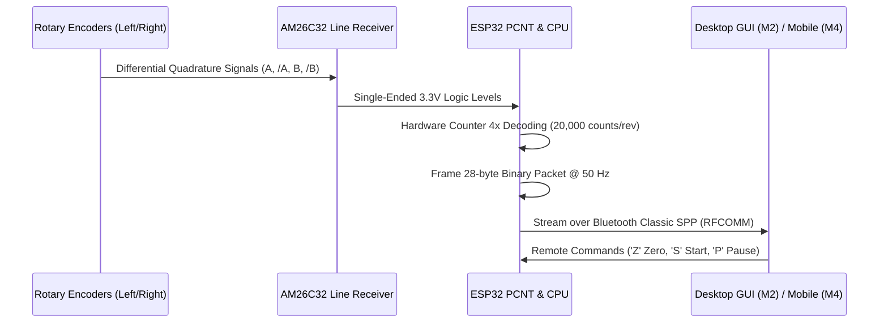

# System Architecture & Technical Specifications

This document outlines the end-to-end system architecture, hardware-software interfaces, data protocols, and algorithmic pipelines of the **Dual-Encoder Wireless Knee Goniometer & Markerless Pose Estimation Comparison System**.

---

## 1. System Overview

The system captures knee flexion-extension kinematics using two independent modalities to evaluate the real-world tracking fidelity of single-camera markerless computer vision against dedicated wearable mechanical rotary encoders:

```text
┌─────────────────────────────────────────────────────────────────┐
│                      SYSTEM ARCHITECTURE                        │
├─────────────┬──────────────┬───────────────┬────────────────────┤
│  MODULE 1   │  MODULE 2    │   MODULE 3    │     MODULE 4       │
│  Hardware & │  Desktop GUI │   Computer    │     Mobile App     │
│  Firmware   │  & Real-Time │   Vision &    │     (React         │
│  (ESP-IDF)  │  Analytics   │   Pose (MP)   │      Native)       │
├─────────────┴──────────────┴───────────────┴────────────────────┤
│                 SHARED UTILITIES & PROTOCOLS                    │
│      Packet Parser  ·  Synthetic Generator  ·  Test Suite       │
└─────────────────────────────────────────────────────────────────┘
```

---

## 2. Detailed Data Flows

### A. Mechanical Telemetry Pipeline (Module 1 → Module 2 / Module 4)



1. **Sensors:** Two optical/magnetic incremental rotary encoders (5000 PPR) are coupled to polycentric knee braces on the lateral sides of the knee joints.
2. **Noise Immunity:** The differential outputs ($A, \bar{A}, B, \bar{B}$) pass through an AM26C32 differential line receiver with $120\,\Omega$ termination resistors to reject common-mode electromagnetic noise.
3. **Hardware Pulse Counting:** An ESP32 microcontroller uses its dedicated hardware Pulse Counter (PCNT) peripheral in 4x edge-counting mode. This achieves $5000 \times 4 = 20{,}000$ counts per revolution ($\approx 0.018^\circ$ step resolution) without CPU cycle overhead.
4. **Firmware State Machine:** Operates on FreeRTOS with a 20 ms ($50\text{ Hz}$) hardware timer task. It reads the cumulative pulse counter, converts counts to calibrated angles, computes CRC-16, and transmits the binary payload.

---

### B. Optical Pose Estimation Pipeline (Module 3)


1. **Camera Geometry:** A monocular RGB camera captures 1080p @ 30 FPS sagittal video placed perpendicular to the motion plane at knee level (distance: $2.5 - 3.0\text{ m}$).
2. **Landmark Detection:** Google MediaPipe Pose extracts 2D normalized coordinates for the camera-facing limb:
   - Hip ($P_{hip}$): Index 23 (Left) or 24 (Right)
   - Knee ($P_{knee}$): Index 25 (Left) or 26 (Right)
   - Ankle ($P_{ankle}$): Index 27 (Left) or 28 (Right)
3. **Vector Trigonometry:**
   $$\vec{u} = P_{hip} - P_{knee}, \quad \vec{v} = P_{ankle} - P_{knee}$$
   $$\alpha = \arccos\left(\text{clip}\left(\frac{\vec{u} \cdot \vec{v}}{\|\vec{u}\| \|\vec{v}\|}, -1.0, 1.0\right)\right)$$
   $$\theta_{camera} = 180^\circ - \alpha$$
4. **Filtering & Quality Control:**
   - Frames where any joint landmark exhibits visibility $v < 0.6$ are flagged as invalid.
   - A 2nd-order low-pass Butterworth filter ($f_c = 6\text{ Hz}$, $f_s = 30\text{ Hz}$) attenuates high-frequency landmark jitter.

---

### C. Temporal Synchronization & Cross-Modal Comparison

Because the encoder stream ($50\text{ Hz}$, $\Delta t = 20\text{ ms}$) and optical stream ($30\text{ FPS}$, $\Delta t \approx 33.3\text{ ms}$) sample at different rates:
1. Each data sample carries a microsecond-precision monotonic timestamp.
2. The initial clock offset between the ESP32 uptime clock and PC system clock is estimated at session start.
3. Optical angles $\theta_{camera}(t)$ are linearly interpolated onto the exact hardware timestamps of the rotary encoder:
   $$\theta_{camera, interp}(t_{enc, i}) = \text{interp}\left(t_{enc, i}, t_{cam}, \theta_{camera}\right)$$
4. Residual lag is validated using cross-correlation during rapid cyclical knee extensions, constrained within $\le 33\text{ ms}$ (one video frame).

---

## 3. Communication Protocol (28-Byte Binary Frame)

```text
+--------+--------+--------+--------+--------+--------+--------+--------+
| 0xAA   | 0x55   | SeqNum (4B)     | TimeMS (4B)     | LeftCount (4B)  |
+--------+--------+--------+--------+--------+--------+--------+--------+
| RightCount (4B) | LeftAngle (4B)  | RightAngle (4B) | CRC16 (2B)      |
+--------+--------+--------+--------+--------+--------+--------+--------+
Total: 28 Bytes @ 50 Hz (~1.4 KB/s throughput)
```

### Struct Layout (Little-Endian)
```c
typedef struct __attribute__((packed)) {
    uint8_t  header[2];      // 0xAA, 0x55
    uint32_t seq_num;        // Incremental sequence counter
    uint32_t timestamp_ms;   // Milliseconds since ESP32 boot
    int32_t  left_count;     // Cumulative encoder counts (left)
    int32_t  right_count;    // Cumulative encoder counts (right)
    float    left_angle;     // Calibrated knee angle in degrees (left)
    float    right_angle;    // Calibrated knee angle in degrees (right)
    uint16_t crc16;          // CRC-16/CCITT over bytes 0-25
} telemetry_packet_t;
```

---

## 4. Quantitative Discrepancy & Statistical Analysis

Module 2 evaluates real-time tracking agreement across functional tasks:

1. **Sliding-Window Metrics (5-second buffer):**
   $$\text{RMSE} = \sqrt{\frac{1}{N}\sum_{i=1}^{N} \left(\theta_{cam}(t_i) - \theta_{enc}(t_i)\right)^2}$$
   $$\text{MAE} = \frac{1}{N}\sum_{i=1}^{N} |\theta_{cam}(t_i) - \theta_{enc}(t_i)|$$

2. **Session Summary Metrics:**
   - Mean Discrepancy / Bias ($\bar{d}$)
   - Peak Flexion Discrepancy ($\Delta\theta_{peak}$)
   - Bland-Altman $95\%$ Limits of Agreement ($\bar{d} \pm 1.96 \cdot SD$)
   - Spearman Rank Correlation ($r_s$) between landmark visibility score and absolute angular error.

---

## 5. Technology Stack Summary

| Subsystem | Technologies & Libraries | Languages |
|:---|:---|:---|
| **Module 1 (Firmware)** | ESP-IDF v5.x, FreeRTOS, PCNT Driver, Bluetooth Classic SPP | C (C99 / C11) |
| **Module 2 (Desktop GUI)** | PyQt6, PyQtGraph, PySerial, NumPy, SciPy, Matplotlib | Python 3.10+ |
| **Module 3 (Pose Vision)** | OpenCV 4.x, Google MediaPipe Pose (BlazePose), NumPy | Python 3.10+ |
| **Module 4 (Mobile App)** | React Native (Expo), react-native-bluetooth-classic, SVG | TypeScript / React |
| **Shared & Testing** | Pytest, Flake8, Struct Unpacking, GitHub Actions CI | Python / YAML |
