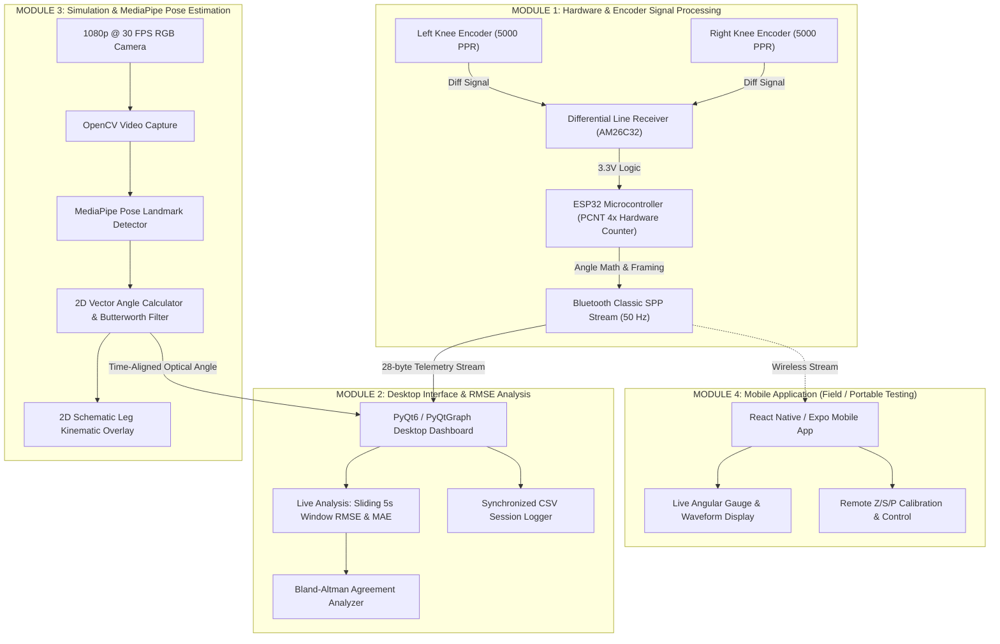

# Dual-Encoder Wireless Knee Goniometer & Markerless Single-Camera Pose Estimation Comparison System

[](LICENSE)
[](https://www.python.org/)
[](https://docs.espressif.com/)
[](https://ai.google.dev/edge/mediapipe/solutions/vision/pose_landmarker)
[](https://github.com/eyyoibo/CSE396-Group11-Knee-Goniometer/actions/workflows/ci.yml)

---

## 📌 Project Overview

This repository hosts a multi-modal biomechanical joint kinematics measurement platform that performs real-time cross-validation between:
1. **A Wearable Dual-Encoder Wireless Goniometer:** An untethered, battery-powered ESP32 system reading two 5000 PPR incremental rotary encoders via hardware pulse counters (PCNT) and streaming telemetry at $50\text{ Hz}$ over Bluetooth Serial (SPP).
2. **A Markerless Optical Pose Estimation Pipeline:** A monocular 1080p @ 30 FPS RGB camera tracking lower-limb landmarks using Google MediaPipe Pose (BlazePose) and calculating knee flexion/extension angles via 2D vector kinematics.
3. **A Real-Time Desktop Dashboard & Analytics Engine:** Synchronizes both data streams, computes sliding-window RMSE/MAE metrics, visualizes 2D schematic kinematics, plots live angle curves, and logs standardized CSV data.
4. **A Companion Mobile Application:** Provides remote wireless monitoring, calibration controls, and field assessment capabilities.

> [!NOTE]
> **Engineering Disclaimer:** This system is an exploratory technical validation prototype and engineering evaluation benchmark. It is not intended as a certified clinical diagnostic or therapeutic medical device.

---

## 👥 Project Team (Group 11)

| Name | Role / Assigned Focus |
|:---|:---|
| **İbrahim Halil Doğan** | Embedded Firmware (ESP32 PCNT), Bluetooth SPP Protocol, Mobile Architecture |
| **Mert Canoğlu** | Computer Vision Pipeline (MediaPipe Pose), Vector Kinematics & Filtering |
| **Cem Baygın** | Benchtop Rig Calibration, Desktop GUI Architecture (PyQt6) & Statistics |
| **Cansu Bulut** | Real-Time Discrepancy Analytics (RMSE/MAE/Bland-Altman), Automated Testing & CI |

---

## 🔬 Research Scope & Hypotheses

* **Primary Research Question:** How do knee flexion-extension angles estimated from single-camera 2D markerless pose estimation compare quantitatively against high-resolution mechanical dual-encoder measurements during functional movements (squat, sit-to-stand, and linear gait)?
* **Hypothesis 1 (H1):** In tasks where the sagittal plane orientation remains perpendicular to the optical axis without limb occlusion (squat and sit-to-stand), the discrepancy (MAE/RMSE) between camera and encoder angle series will be significantly lower than in gait trials where self-occlusion occurs.
* **Hypothesis 2 (H2):** Landmark visibility scores ($v < 0.6$) and invalid frame ratios reported by MediaPipe will exhibit a strong positive correlation (Spearman rank correlation $r_s$) with instantaneous absolute angle discrepancy ($|\theta_{cam} - \theta_{enc}|$).

---

## 🏗️ System Architecture



---

## 📁 Repository Directory Structure

```text
knee-goniometer-pose-estimation/
├── .github/
│   ├── ISSUE_TEMPLATE/        # Standardized issue templates (bug, feature, task)
│   ├── workflows/             # GitHub Actions CI workflow (flake8, pytest)
│   ├── copilot-instructions.md# AI agent & contributor code standards
│   └── pull_request_template.md# Pull request review checklist
│
├── module1_hardware_encoder/  # MODULE 1: ESP32 Firmware & Signal Hardware
│   ├── README.md              # Hardware specs, 4x PCNT decoding, Z/S/P protocol
│   ├── platformio.ini         # PlatformIO ESP-IDF build configuration
│   ├── include/               # C telemetry struct and configuration headers
│   ├── src/                   # Firmware state machine & driver stubs
│   └── docs/WIRING.md         # AM26C32 differential receiver wiring diagrams
│
├── module2_interface_rmse/    # MODULE 2: Desktop GUI & Statistical Discrepancy Engine
│   ├── README.md              # PyQt6 GUI architecture, MAE/RMSE/Bland-Altman math
│   ├── requirements.txt       # Python dependencies (PyQt6, pyqtgraph, pyserial, etc.)
│   └── src/                   # GUI layout, background receiver QThread, statistics
│
├── module3_mediapipe_simulation/ # MODULE 3: Optical Pose Pipeline & 2D Kinematics
│   ├── README.md              # MediaPipe pipeline, vector angle formulations
│   ├── requirements.txt       # Vision dependencies (OpenCV, MediaPipe, SciPy)
│   └── src/                   # Video capture, landmark detection, interpolation
│
├── module4_mobile_app/        # MODULE 4: Cross-Platform Mobile Application
│   ├── README.md              # React Native / Expo architecture & field testing
│   ├── package.json & app.json# Mobile dependencies and permissions
│   ├── docs/SCREENS.md        # UI/UX specifications for 5 primary app screens
│   └── src/                   # Screen components, gauges, Bluetooth service
│
├── shared/                    # Shared Cross-Module Utilities
│   ├── packet_parser.py       # Binary 28-byte packet unpacker and CRC-16 validator
│   ├── synthetic_data_generator.py # Hardware-free test stream generator (serial/TCP)
│   └── sample_session.csv     # Canonical multi-modal CSV output format
│
├── tests/                     # Automated Test Suite (pytest)
│   ├── test_packet_parser.py  # Binary framing & CRC test cases
│   ├── test_angle_calculator.py# Optical trigonometry & Butterworth filter tests
│   └── test_analysis_engine.py# Sliding RMSE, MAE, and Bland-Altman math tests
│
├── docs/                      # Technical Documentation & Protocols
│   ├── experiment_protocol.md # 15-participant experimental & ethical protocol
│   ├── issues/                # 16 complete pre-written Markdown issue files
│   └── legacy_v1_code/        # Archived initial prototype reference files
│
├── scripts/
│   └── create_github_issues.py# CLI tool to synchronize issues with GitHub API
│
├── ARCHITECTURE.md            # Comprehensive system architecture & data contract
├── CONTRIBUTING.md            # Git branching, commit conventions, and PR workflow
├── PROJECT_BOARD.md           # GitHub Projects Kanban board setup & sprint guide
├── AGENTS.md                  # Autonomous agent & contributor operational guide
├── LICENSE                    # MIT License
└── requirements.txt           # Unified root dependency specifications
```

---

## 📡 Telemetry Protocol Specification

The ESP32 firmware streams fixed 28-byte binary packets at $50\text{ Hz}$ over Bluetooth SPP:

| Offset | Field | Type | Size | Description |
|:---:|:---|:---:|:---:|:---|
| 0 | `header` | uint8[2] | 2B | Magic packet header (`0xAA 0x55`) |
| 2 | `seq_num` | uint32_t | 4B | Monotonically incrementing packet counter |
| 6 | `timestamp_ms`| uint32_t | 4B | ESP32 hardware monotonic uptime (milliseconds) |
| 10 | `left_count` | int32_t | 4B | Left knee cumulative encoder quadrature count |
| 14 | `right_count`| int32_t | 4B | Right knee cumulative encoder quadrature count |
| 18 | `left_angle` | float32 | 4B | Left knee calibrated flexion angle (degrees) |
| 22 | `right_angle`| float32 | 4B | Right knee calibrated flexion angle (degrees) |
| 26 | `crc16` | uint16_t | 2B | CRC-16/CCITT checksum over bytes 0-25 |

### Remote Control Commands
Host devices (desktop or mobile) transmit single-byte ASCII control characters to the ESP32:
* **`'Z'` (Zero):** Records current encoder positions as the zero-extension baseline reference ($0.0^\circ$).
* **`'S'` (Start):** Initiates periodic $50\text{ Hz}$ telemetry transmission and logging.
* **`'P'` (Pause):** Halts telemetry streaming while maintaining current calibration offsets.

---

## 📐 Mathematical Formulations

### 1. Rotary Encoder Angular Resolution
With 5000 Pulses Per Revolution (PPR) and 4x quadrature edge decoding executed by the ESP32 PCNT hardware counters:

$$\text{Counts Per Revolution} = 5000 \times 4 = 20{,}000\text{ counts/rev}$$

$$\Delta\theta = \frac{360.0^\circ}{20{,}000} = 0.018^\circ/\text{count}$$

$$\theta_{encoder}(t) = \left(N(t) - N_{offset}\right) \times 0.018^\circ$$

### 2. Optical Vector Dot Product Angle Calculation
Given 2D pixel coordinates for hip ($P_{hip}$), knee ($P_{knee}$), and ankle ($P_{ankle}$):

$$\vec{u} = P_{hip} - P_{knee}, \quad \vec{v} = P_{ankle} - P_{knee}$$

$$\alpha = \arccos\left(\frac{\vec{u} \cdot \vec{v}}{\|\vec{u}\| \|\vec{v}\|}\right)$$

$$\theta_{camera} = 180^\circ - \alpha$$

*(Clamped to $[-1.0, 1.0]$ prior to $\arccos$ calculation to prevent numerical domain errors).*

### 3. Quantitative Discrepancy & Statistical Agreement
* **Mean Absolute Error (MAE):** $\text{MAE} = \frac{1}{N}\sum_{i=1}^{N} |\theta_{camera}(t_i) - \theta_{encoder}(t_i)|$
* **Root Mean Square Error (RMSE):** $\text{RMSE} = \sqrt{\frac{1}{N}\sum_{i=1}^{N} (\theta_{camera}(t_i) - \theta_{encoder}(t_i))^2}$
* **Mean Bias ($\bar{d}$):** $\bar{d} = \frac{1}{N}\sum_{i=1}^{N} (\theta_{camera}(t_i) - \theta_{encoder}(t_i))$
* **Bland-Altman 95% Limits of Agreement:** $\text{LoA} = \bar{d} \pm 1.96 \cdot SD$

---

## 🚀 Quickstart & Hardware-Free Testing

### 1. Clone & Set Up Python Environment
```bash
git clone https://github.com/eyyoibo/CSE396-Group11-Knee-Goniometer.git
cd CSE396-Group11-Knee-Goniometer

# Create virtual environment
python -m venv venv

# Activate virtual environment
# Windows:
.\venv\Scripts\activate
# Linux/macOS:
source venv/bin/activate

# Install module requirements
pip install -r module2_interface_rmse/requirements.txt
pip install -r module3_mediapipe_simulation/requirements.txt
```

### 2. Run Automated Unit Tests
```bash
pytest tests/ -v
```

### 3. Test Desktop GUI with Synthetic Telemetry Stream
You can test the entire pipeline without physical ESP32 hardware:
```bash
# Terminal 1: Launch synthetic 50 Hz squat generator
python shared/synthetic_data_generator.py --tcp 127.0.0.1:9000 --hz 50 --noise 0.3
```

---

## 📋 Project Management & Development Guidelines

* **System Architecture & Data Contracts:** [`ARCHITECTURE.md`](ARCHITECTURE.md)
* **GitHub Projects Kanban Guide:** [`PROJECT_BOARD.md`](PROJECT_BOARD.md)
* **Contribution & Branching Rules:** [`CONTRIBUTING.md`](CONTRIBUTING.md)
* **Agent & Developer Guidelines:** [`AGENTS.md`](AGENTS.md) and [`.github/copilot-instructions.md`](.github/copilot-instructions.md)
* **Pre-Written Issue Catalog:** [`docs/issues/`](docs/issues/) (16 issues ready for GitHub Projects)

---

## 📄 License
This project is open-source software licensed under the [MIT License](LICENSE).
Copyright (c) 2024-2026 İbrahim Halil Doğan, Mert Canoğlu, Cem Baygın, Cansu Bulut.
