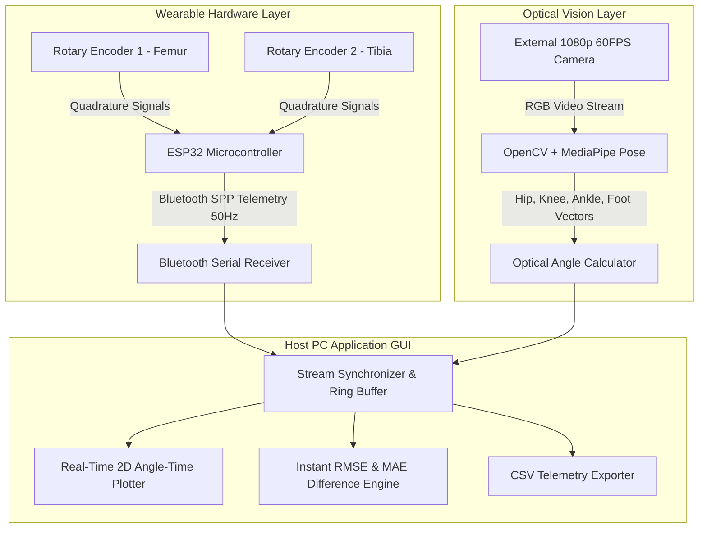

# Wireless Wearable Dual-Encoder Knee Goniometer & Vision-Based Lower-Limb Kinematics Analyzer

[](https://github.com/eyyoibo/CSE396-Group11-Knee-Goniometer/actions/workflows/ci_tests.yml)
[](https://www.python.org/)
[](https://www.espressif.com/)
[](LICENSE)

**CSE 396 Computer Engineering Project Proposal — Group 11**  
**Gebze Technical University (GTU) — Department of Computer Engineering**

---

## 👥 Project Information & Team Members

* **Academic Advisor:** Prof. Dr. Erkan Zergeroğlu  
* **Group:** Group 11  
* **Repository:** [eyyoibo/CSE396-Group11-Knee-Goniometer](https://github.com/eyyoibo/CSE396-Group11-Knee-Goniometer)  
* **Proposal Document:** [docs/Group11_Proposal.pdf](docs/Group11_Proposal.pdf)

| Member | Role / Assigned Modules |
| :--- | :--- |
| **İbrahim Halil Doğan** | Mechanical & Wireless ESP32 Hardware, Dual-Encoder Kinematics, CI/CD Automation |
| **Mert Canoğlu** | ESP32 Hardware Interfacing, Computer Vision Knee & Ankle Analyzer |
| **Cem Baygın** | Kinematics & Calibration Routines, GUI Desktop Dashboard & Real-Time Plotter |
| **Cansu Bulut** | MediaPipe Pose Optical Analyzer, GUI Metrics Visualizer, Integration & Unit Tests |

---

## 📌 Executive Summary

Accurate tracking of lower-limb joint kinematics (Range of Motion - ROM) is vital for sports biomechanics, athletic performance monitoring, and injury rehabilitation. Traditional optical motion capture systems require expensive, controlled laboratory setups, while wired mechanical goniometers physically restrict athletic movement.

This project addresses these challenges through a **dual-modal cross-validation architecture**:
1. **Wireless Wearable Goniometer:** An untethered, battery-powered ESP32 microcontroller interfaces with two incremental rotary encoders mounted on a polycentric knee brace, calculating real-time knee flexion/extension angles and streaming telemetry at $\ge 50\text{ Hz}$ over Bluetooth Serial (SPP).
2. **Markerless Computer Vision Pipeline:** An external RGB camera processes sagittal video using OpenCV and Google MediaPipe Pose (BlazePose) at $30\text{ FPS}$, calculating optical knee angles for independent cross-validation while simultaneously computing ankle joint dorsiflexion and plantarflexion.
3. **Synchronized Desktop Dashboard:** Receives both asynchronous streams, aligns timestamps, overlays skeletal tracking on video, plots real-time Angle-vs-Time curves, and outputs instant discrepancy analytics ($\text{RMSE}$ and $\text{MAE}$).

---

## 🏗️ System Architecture



---

## 📐 Mathematical Formulations

### 1. Dual-Encoder Polycentric Kinematic Superposition
The human knee operates with a polycentric (moving) axis of rotation. The combined knee flexion angle $\theta_{knee, enc}(t)$ is obtained via kinematic superposition:

$$\theta_{knee, enc}(t) = \theta_0 + k_1 \Delta N_1(t) + k_2 \Delta N_2(t)$$

Where:
* $\Delta N_1, \Delta N_2$: Net quadrature pulse counts from encoders 1 and 2.
* $k_1, k_2$: Angular calibration constants derived from encoder resolution ($\text{PPR} = 600 \implies k = 360^\circ / 600 = 0.6^\circ/\text{pulse}$).
* $\theta_0$: Calibrated zero-extension baseline offset.

### 2. Optical Vector Dot Product Formulation
From extracted sagittal anatomical landmarks ($P_{hip}$, $P_{knee}$, $P_{ankle}$, $P_{foot}$):

$$\vec{u} = P_{hip} - P_{knee}, \quad \vec{v} = P_{ankle} - P_{knee}, \quad \vec{w} = P_{foot} - P_{ankle}$$

The optical knee and ankle angles are computed via:

$$\theta_{knee, cam} = \arccos\left(\frac{\vec{u} \cdot \vec{v}}{\|\vec{u}\| \|\vec{v}\|}\right) \cdot \frac{180^\circ}{\pi}$$

$$\theta_{ankle, cam} = \arccos\left(\frac{-\vec{v} \cdot \vec{w}}{\|-\vec{v}\| \|\vec{w}\|}\right) \cdot \frac{180^\circ}{\pi}$$

### 3. Cross-Modal Discrepancy Metrics

$$\text{RMSE} = \sqrt{\frac{1}{N}\sum_{i=1}^{N} \left(\theta_{enc}(t_i) - \theta_{cam}(t_i)\right)^2}, \quad \text{MAE} = \frac{1}{N}\sum_{i=1}^{N} |\theta_{enc}(t_i) - \theta_{cam}(t_i)|$$

---

## 📁 Repository Directory Structure

```text
CSE396-Group11-Knee-Goniometer/
├── .github/
│   └── workflows/
│       └── ci_tests.yml       # Automated GitHub Actions Flake8 + Pytest CI
├── docs/
│   └── Group11_Proposal.pdf   # Official CSE396 Project Proposal Document
├── firmware_esp32/            # Module 1: ESP32 C++ Arduino Firmware
│   └── esp32_encoder.ino      # Quadrature ISRs, PCNT, and Bluetooth SPP streaming
├── src/                       # Python Core Modules
│   ├── __init__.py
│   ├── kinematics.py          # Module 2: Pulse conversion, superposition & error math
│   ├── vision_tracker.py      # Module 3: OpenCV + MediaPipe vector angle calculations
│   └── gui_app.py             # Module 4: Real-time GUI dashboard and stream sync
├── tests/                     # Module 5: Automated Test Suite
│   └── test_angles.py         # Pytest unit tests for kinematics & vision math
├── .gitignore                 # Standard Python & embedded gitignore
├── requirements.txt           # Project dependencies
└── README.md                  # Project overview and technical documentation
```

---

## 🚀 Quickstart & Setup

### 1. Clone & Set Up Python Environment
```bash
# Clone the repository
git clone https://github.com/eyyoibo/CSE396-Group11-Knee-Goniometer.git
cd CSE396-Group11-Knee-Goniometer

# Create virtual environment
python -m venv venv

# Activate virtual environment
# Windows:
.\venv\Scripts\activate
# Linux/macOS:
source venv/bin/activate

# Install dependencies
pip install -r requirements.txt
```

### 2. Run Automated Unit Tests Locally
All unit tests can be executed without requiring physical hardware or a camera attached:
```bash
pytest tests/ -v
```

### 3. Run Syntax & Style Checks (Flake8)
```bash
flake8 . --count --select=E9,F63,F7,F82 --show-source --statistics
```

### 4. Run Desktop GUI Simulation Demo
```bash
python -m src.gui_app
```

---

## ⚡ ESP32 Hardware Firmware Setup

1. Open `firmware_esp32/esp32_encoder.ino` in the **Arduino IDE** or **PlatformIO**.
2. Select your board: **ESP32 Dev Module**.
3. Wire the two rotary encoders to the ESP32 GPIO pins:
   * **Encoder 1 (Femur):** Phase A $\rightarrow$ GPIO 18, Phase B $\rightarrow$ GPIO 19
   * **Encoder 2 (Tibia):** Phase A $\rightarrow$ GPIO 22, Phase B $\rightarrow$ GPIO 23
4. Compile and flash the firmware over USB.
5. Once powered on, the ESP32 advertises Bluetooth device name `KneeGoniometer_Group11`.
6. Pair your PC with `KneeGoniometer_Group11` to start receiving live CSV telemetry at $50\text{ Hz}$.
7. Send ASCII character `'Z'` over Bluetooth to trigger instant zero-extension calibration.

---

## 🤝 Team Contribution & Branching Strategy

To maintain repository stability and ensure all code merges pass automated testing:

1. **Never commit directly to `main`.**
2. Create a dedicated feature branch for your assigned module:
   ```bash
   git checkout -b feature/esp32-encoder
   # or
   git checkout -b feature/mediapipe-vision
   # or
   git checkout -b feature/gui-dashboard
   ```
3. Commit your changes with clear, descriptive messages:
   ```bash
   git add .
   git commit -m "feat(vision): implement 2D vector dot product knee angle calculation"
   ```
4. Push your branch to GitHub:
   ```bash
   git push origin feature/your-feature-name
   ```
5. Open a **Pull Request (PR)** against `main`.
6. GitHub Actions will automatically run the test suite. Once the green checkmark ($\checkmark$) appears, request a review from a teammate and merge.

---

## 📄 License
This project is developed for educational and research purposes under the **CSE 396 Computer Engineering Project** course at Gebze Technical University.